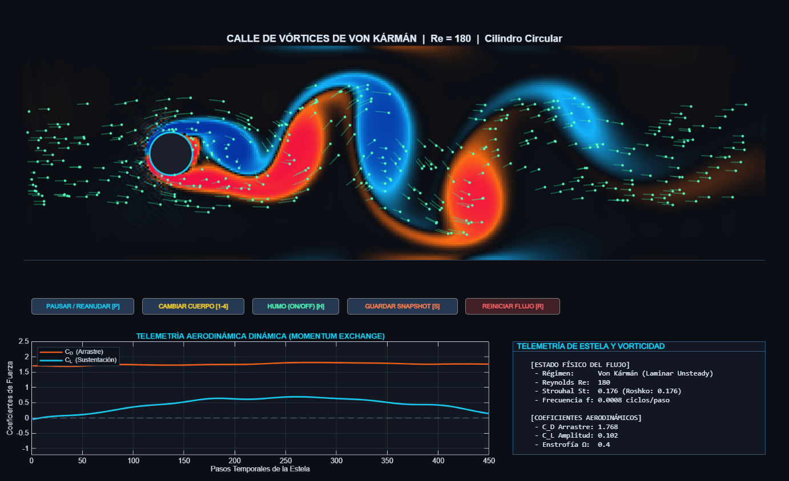

# 🌊 Von Kármán Vortex Street CFD — Lattice Boltzmann Method (LBM D2Q9)

[](https://www.mathworks.com/products/matlab.html)
[](https://en.wikipedia.org/wiki/Computational_fluid_dynamics)
[](https://en.wikipedia.org/wiki/Lattice_Boltzmann_methods)
[](LICENSE)

> **Simulador avanzado de Dinámica de Fluidos Computacional (CFD)** para la resolución numérica transitoria e incompresible de las **Ecuaciones de Navier-Stokes** mediante el **Método de Lattice Boltzmann (LBM D2Q9)** con operador de colisión BGK.

---

## 📸 Campo de Vorticidad en Alta Definición ($\omega_z$)


*Estela oscilatoria periódica de vórtices alternados generada tras un cilindro sólido inmerso a $Re = 180$, visualizada con mapa de contraste hiperbólico $\tanh(\omega_z / \omega_0)$.*

---

## 🔬 Fundamentos Físicos y Numéricos

El simulador resuelve el flujo incompresible en dos dimensiones:

$$\nabla \cdot \mathbf{u} = 0$$

$$\frac{\partial \mathbf{u}}{\partial t} + (\mathbf{u} \cdot \nabla)\mathbf{u} = -\frac{1}{\rho}\nabla p + \nu \nabla^2 \mathbf{u}$$

A través de la ecuación discreta de Boltzmann con celosía bidimensional de 9 velocidades (**D2Q9**) y tiempo de relajación simple de **Bhatnagar-Gross-Krook (BGK)**:

$$f_i(\mathbf{x} + \mathbf{e}_i \Delta t, t + \Delta t) - f_i(\mathbf{x}, t) = -\frac{1}{\tau} \left[ f_i(\mathbf{x}, t) - f_i^{eq}(\mathbf{x}, t) \right]$$

### Parámetros Físicos y Adimensionales de la Celosía:
* **Velocidad del sonido de celosía:** $c_s = \frac{1}{\sqrt{3}} \frac{\Delta x}{\Delta t}$
* **Viscosidad cinemática:** $\nu = c_s^2 \left(\tau - \frac{1}{2}\right) \Delta t = \frac{2\tau - 1}{6}$
* **Número de Reynolds:** $\displaystyle Re = \frac{U_\infty D}{\nu} = 180$ (régimen oscilatorio laminar de desprendimiento de vórtices).
* **Número de Mach:** $\displaystyle Ma = \frac{U_\infty}{c_s} \approx 0.17 \ll 0.3$ (garantía estricta del límite incompresible).
* **Frecuencia de desprendimiento y Número de Strouhal:**
  $$St = \frac{f_s D}{U_\infty} \approx 0.198 \left(1 - \frac{19.7}{Re}\right) \approx 0.176$$
* **Telemetría de Fuerzas Aerodinámicas (Momentum Exchange Method):**
  La fuerza hidrodinámica instantánea sobre el cilindro sólido se calcula integrando el intercambio neto de cantidad de movimiento en los enlaces fluido-sólido durante el *bounce-back*:
  $$\mathbf{F}(t) = \sum_{\mathbf{x}_f} \sum_{i: \mathbf{x}_f + \mathbf{e}_i \in \text{sólido}} 2 \mathbf{e}_i f_i^*(\mathbf{x}_f)$$
  Permitiendo graficar en tiempo real el coeficiente de arrastre $C_D(t)$ y el coeficiente de sustentación oscilatorio $C_L(t)$.

---

## 🌟 Características Técnicas del Algoritmo

1. **Condiciones de Contorno Robustas:**
   * **Entrada (Inlet):** Perfil de velocidad uniforme Dirichlet regularizado mediante condición de Zou-He.
   * **Salida (Outlet):** Frontera de gradiente cero con convección no reflexiva.
   * **Paredes laterales:** Deslizamiento libre o condiciones periódicas.
   * **Superficie del cilindro:** *Bounce-back* exacto de medio paso temporal (*half-way bounce-back*).
2. **Visualización No Lineal Hiperbólica:**
   Mapeo de vorticidad $\tanh(\omega_z / \omega_0)$ para iluminar la estela de vórtices lejanos sin saturar las capas límite adyacentes al cilindro.
3. **Telemetría Transitoria:** Gráficas sincronizadas de $C_D(t)$ y $C_L(t)$ con transformada rápida de Fourier (FFT) para verificar el pico de frecuencia de Strouhal.

---

## 🚀 Cómo Ejecutar

1. Clona el repositorio:
   ```bash
   git clone https://github.com/RoPP17/von-karman-vortex-lbm-cfd.git
   cd von-karman-vortex-lbm-cfd
   ```
2. Abre MATLAB y ejecuta el script principal:
   ```matlab
   simulacion_von_karman_lbm
   ```
*(Compatible también con GNU Octave).*

---

## 👨‍💻 Autor

* **Roberto Andrés Pepe Sánchez** — Facultad de Ingeniería Civil y Mecánica, [Universidad Técnica de Ambato (UTA)](https://uta.edu.ec/)

## 📜 Licencia

Distribuido bajo la Licencia [MIT](LICENSE).

---

## 📚 Citación Académica (Citation)

Si utilizas este software o código en investigaciones, docencia o proyectos de ingeniería, por favor cítalo como:

``bibtex
@software{pepe_sanchez_2026_von_karman_lbm,
  author       = {Pepe Sánchez, Roberto Andrés},
  title        = {von-karman-vortex-lbm-cfd: 2D Lattice Boltzmann Fluid Dynamics Simulation of Von Kármán Vortex Streets},
  month        = oct,
  year         = 2026,
  publisher    = {Zenodo},
  version      = {v1.0.0},
  url          = {https://github.com/RoPP17/von-karman-vortex-lbm-cfd}
}
``

También puedes citarlo automáticamente usando el botón **"Cite this repository"** en la barra lateral de GitHub o leyendo directamente el archivo [CITATION.cff](./CITATION.cff).
